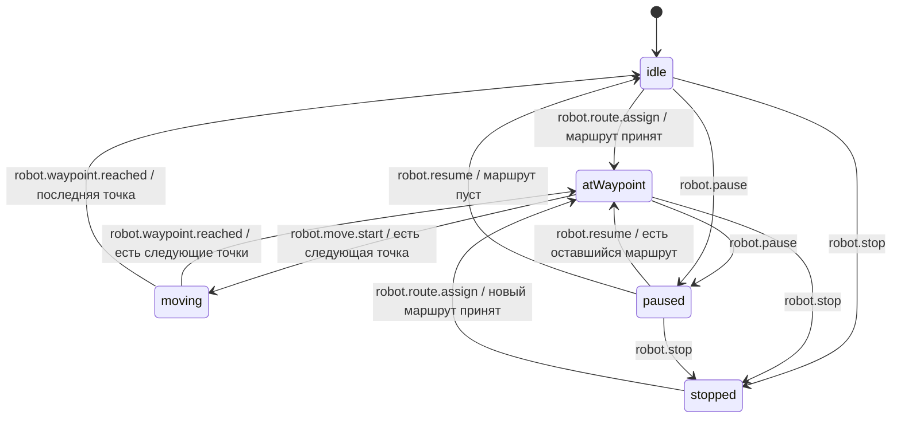
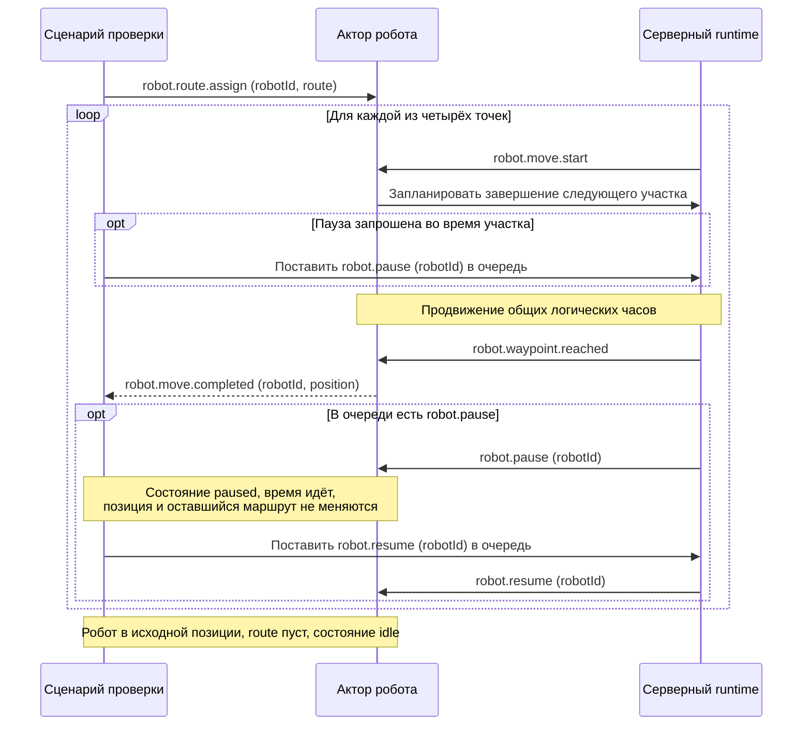

# Робот: минимальный MVP

## Цель

На бэкенде создать одного XState-актора робота, передать ему круговой маршрут и проверить прохождение одного полного круга с паузой и продолжением, а отдельным сценарием — остановку во время прохождения. Здесь круговой маршрут означает замкнутую последовательность клеток, а не геометрическую окружность или бесконечное повторение.

## Сценарий

1. Создать робота с ID и начальной позицией `{ x: 1, y: 1 }` в состоянии `idle`.
2. Создать маршрут: `(2,1) → (2,2) → (1,2) → (1,1)`. Начальная клетка не дублируется в начале массива; последняя совпадает с исходной позицией робота.
3. Передать роботу `robot.route.assign` с его ID и маршрутом.
4. Робот последовательно проходит четыре соседние клетки. Переход занимает заданное в настройках runtime положительное число логических тиков.
5. При каждом прибытии робот обновляет позицию, сообщает `robot.move.completed` и переходит к следующему участку. После последнего участка возвращается в исходную позицию и остаётся в `idle`; новый круг автоматически не начинается.
6. Во время одного из промежуточных переходов поставить `robot.pause` в очередь управления. Робот завершает текущий участок; затем команда доставляется и переводит его в `paused` до начала следующего участка.
7. Продвинуть время и проверить отсутствие движения. Передать `robot.resume` и проверить продолжение оставшейся части того же маршрута до возврата в исходную позицию.

Полный диспетчер, разрешения движения и периодические опросы относятся к [полной модели](robot.md). В MVP серверный runtime или сценарий проверки предоставляет минимальную очередь управления для `pause`, `resume` и `stop`; робот своей очереди не хранит. Один робот выполняет маршрут без конфликтов с другими роботами.

## Минимальные типы

```ts
declare const brand: unique symbol;

type Brand<Value, Name extends string> = Value & {
  readonly [brand]: Name;
};

type RobotId = Brand<string, "RobotId">;
type CoordinateX = Brand<number, "CoordinateX">;
type CoordinateY = Brand<number, "CoordinateY">;

type Position = { x: CoordinateX; y: CoordinateY };

type RobotContext = {
  id: RobotId;
  position: Position;
  route: Position[];
};

type RobotCommand =
  | { type: "robot.route.assign"; robotId: RobotId; route: Position[] }
  | { type: "robot.pause"; robotId: RobotId }
  | { type: "robot.resume"; robotId: RobotId }
  | { type: "robot.stop"; robotId: RobotId };

type RobotInternalEvent =
  | { type: "robot.move.start" }
  | { type: "robot.waypoint.reached" };

type RobotEvent = RobotCommand | RobotInternalEvent;

type RobotToRuntimeEvent = {
  type: "robot.move.completed";
  robotId: RobotId;
  position: Position;
};
```

`route` содержит оставшиеся точки; следующая — `route[0]`. Состояние машины не дублируется в контексте. Номер тика, отдельные ID шага, задания и назначения для этого сценария не нужны.

ID создаётся через фабрику с проверкой непустой строки; координаты — через фабрики неотрицательных безопасных целых чисел. Бренд сам по себе не выполняет runtime-валидацию. Границы поля проверяются отдельно при принятии маршрута.

## Валидация маршрута

Принимается непустой маршрут, в котором каждая следующая клетка соседняя по четырём направлениям, все координаты находятся в пределах поля 10 × 10 (`0..9`), а последняя совпадает с текущей позицией робота. Проверка начинается с текущей позиции, а не со второй точки массива.

Назначение маршрута применяется только в `idle` или `stopped`. Во всех командах проверяется совпадение `robotId`. Некорректная команда отклоняется до изменения контекста и записывается в серверный лог. Поле содержит полки: исходная позиция и все точки маршрута должны быть проходимыми. Статичную планировку задаёт сценарий/runtime; она не дублируется в контексте робота. Автоматический поиск пути не входит в MVP: готовый маршрут задаётся по проходам и проверяется перед принятием.

## Состояния и переходы



`atWaypoint` — состояние между участками. Сначала runtime обрабатывает очередь управления, затем, если робот остался в `atWaypoint` и маршрут непуст, доставляет внутреннее `robot.move.start`. Это порядок исполнения внутри runtime, а не разрешение диспетчера. Немедленный безусловный переход в `moving` не используется: он не должен обходить ожидающую паузу. Runtime регистрирует одно завершение участка по общим логическим часам и затем доставляет `robot.waypoint.reached`.

## Пауза и продолжение

- `robot.pause` не привязан к номеру тика и сохраняется в очереди runtime до доставки. Если робот в `moving`, текущий участок завершается; команда остаётся у runtime и не передаётся в локальную очередь робота.
- После прибытия runtime сначала доставляет ожидающую `robot.pause`, а не `robot.move.start`. Актор переходит в `paused`, сохраняя достигнутую позицию и оставшиеся точки маршрута.
- В `paused` новые участки не планируются; продвижение времени не меняет позицию и маршрут. Оставшееся событие `robot.move.start`, если оно уже было поставлено в обработку, вне `atWaypoint` не запускает движение.
- `robot.resume` применяется только в `paused` и при совпадении `robotId`. При непустом маршруте возвращает в `atWaypoint`, после чего runtime может начать следующий участок. При пустом маршруте возвращает в `idle`.
- Пауза после последнего участка сохраняет уже завершённый круг; `resume` не запускает новый круг. Повторная пауза в `paused` не меняет данные, `resume` вне `paused` отклоняется.

В MVP команды и завершения доставляются runtime однократно и последовательно. Если пауза поступила после начала очередного участка, она применяется после этого участка; уже начатый переход не прерывается.

## Остановка

- `robot.stop` содержит `robotId` и не привязан к тику. Если робот в `moving`, команда остаётся в очереди runtime до завершения текущего участка.
- После прибытия runtime доставляет ожидающий `robot.stop` до `robot.move.start`. Робот сохраняет достигнутую позицию, очищает оставшийся маршрут и переходит в `stopped`.
- В `stopped` новые участки не планируются. Продвижение времени и оставшееся внутреннее `robot.move.start` не запускают движение.
- `robot.resume` из `stopped` отклоняется: очищенный маршрут не восстанавливается. Возобновить работу можно только новым `robot.route.assign`, проверенным относительно текущей позиции.
- `robot.stop` в `paused` очищает сохранённый маршрут; повторный `stop` в `stopped` ничего не меняет. Актор остаётся живым.

`pause` сохраняет оставшийся маршрут, `stop` удаляет его. Команды управления обрабатываются в порядке очереди до начала следующего участка.

## Завершение участка

При обработке прибытия в `moving` актор атомарно:

1. Записывает `route[0]` как новую достигнутую позицию.
2. Удаляет выполненную точку из маршрута.
3. Отправляет `robot.move.completed` с новой позицией.
4. Переходит в `atWaypoint`, если маршрут продолжается, либо в `idle`, если точек больше нет.

Все переходы выполняются на бэкенде. Внутренние события доставляет только runtime; внешний API их не принимает. Защита от повторной доставки событий — следующий этап. Актор не удаляется после прохождения круга, паузы или остановки.

## Обмен событиями



Планирование участка на схеме — внутренний вызов адаптера runtime, а не дополнительная команда `RobotEvent`. Создание, принятие команды и прибытия фиксируются в серверном логе.

## HTML-визуализатор области и проигрыватель лога

### Поле и обозначения

В MVP реализуется локальная HTML-страница с визуализатором квадратной матрицы **10 × 10**. Координаты — от `0` до `9`: `x` растёт слева направо, `y` сверху вниз. Поле содержит проходимые клетки и непроходимые клетки полок. На странице всегда 10 строк по 10 квадратных клеток; подписи координат и служебная информация располагаются отдельно.

| Объект или состояние | Ячейка ASCII | Пояснение |
|---|---|---|
| Свободная проходимая клетка | пробел | Пустая ячейка |
| Полка, непроходимая клетка | `#` | Непроходимая клетка полки |
| Проходимая клетка оставшегося маршрута | `.` | Оставшаяся часть маршрута |
| Активный робот | `O` | Состояния `atWaypoint` и `moving` |
| Робот без маршрута | `L` | Состояние `idle` |
| Робот на паузе | `P` | Состояние `paused` |
| Остановленный робот | `S` | Состояние `stopped` |

Отрисовка послойная: сначала статичное поле с полками, затем маршрут по проходимым клеткам, поверх него робот. Робот или маршрут на полке означают ошибку данных и не должны скрывать полку. Одна клетка содержит одно обозначение объекта; робот имеет приоритет над маршрутом. Повторное посещение клетки в маршруте не создаёт нескольких обозначений. После прохождения точки её отметка исчезает, если эта клетка больше не встречается в оставшемся маршруте. В `paused` маршрут сохраняется, после `stop` исчезает вместе с очищенным маршрутом.

Во время `moving` робот отображается на последней достигнутой координате: перенос символа выполняется только после `robot.waypoint.reached`. Интерполяция между клетками в MVP не нужна. При завершении круга в исходной клетке отображается `L`, после остановки на промежуточной — `S`.

### Квадратная HTML-сетка

Проигрыватель реализуется как локальная HTML-страница с CSS и JavaScript. Поле — CSS Grid из 10 столбцов и 10 строк с одинаковым размером клетки, например **24 × 24 CSS px**. Внутренняя область имеет размер **240 × 240 CSS px** и соотношение сторон 1:1 независимо от пропорций шрифта.

```css
.warehouse-grid {
  display: grid;
  grid-template-columns: repeat(10, 24px);
  grid-template-rows: repeat(10, 24px);
  gap: 0;
}

.warehouse-cell {
  box-sizing: border-box;
  display: grid;
  place-items: center;
  padding: 0;
  margin: 0;
  font: 16px monospace;
}
```

В каждой клетке один ASCII-символ: пробел, `.`, `#`, `O`, `L`, `P` или `S`. Вокруг символа не добавляются текстовые пробелы или скобки. `gap`, отступы и промежутки между клетками равны нулю; размеры задаёт геометрия HTML-элемента. Пустой элемент обозначает одну свободную клетку и не схлопывается. Полки занимают соседние клетки без свободных промежутков; их фон можно объединять визуально, сохраняя `#` внутри каждой клетки.

Рамка и подписи координат располагаются снаружи сетки и не меняют размер её клеток. Размер клетки может настраиваться, но ширина всегда равна высоте, все клетки одинаковы. При масштабировании используется один коэффициент для обеих осей. Цвет необязателен: обозначения должны читаться без него.

Консольный вывод допустим как дополнительная диагностика. Квадратные пропорции обязательны для HTML-поля; настройка терминального шрифта больше не является требованием MVP. Текстовые примеры ниже показывают содержимое клеток, а не физические пропорции готового HTML-поля.

### Пример сетки склада и кольцевого маршрута

Поле **10 × 10**, три блока полок по два столбца и четыре строки: `x = 0..1`, `4..5`, `8..9`, во всех случаях `y = 3..6`. Полки обозначены `#`: эти клетки непроходимы. Всего 24 клетки полок и 76 проходимых клеток. Между полками остаются вертикальные проходы, над и под ними — поперечные.

Кольцевой маршрут обходит центральный блок полок: старт `(2,2)`, затем по верхнему проходу до `(7,2)`, по правому до `(7,7)`, по нижнему до `(2,7)` и обратно в `(2,2)` по левому. В массиве маршрута перечисляются все соседние клетки каждого участка, а не только углы. Заголовок показывает `x`, номера строк — `y`. В HTML каждая клетка занимает квадратный элемент с одним символом; текстовая схема ниже не задаёт её экранные размеры.

**idle: робот L в (2,2), маршрут не назначен**

```text
  0123456789
 +----------+
0|          |
1|          |
2|  L       |
3|##  ##  ##|
4|##  ##  ##|
5|##  ##  ##|
6|##  ##  ##|
7|          |
8|          |
9|          |
 +----------+
```

**moving: робот O в (2,2), идёт к (3,2)**

```text
  0123456789
 +----------+
0|          |
1|          |
2|  O.....  |
3|##. ## .##|
4|##. ## .##|
5|##. ## .##|
6|##. ## .##|
7|  ......  |
8|          |
9|          |
 +----------+
```

**paused: робот P в (3,2), маршрут сохранён**

```text
  0123456789
 +----------+
0|          |
1|          |
2|  .P....  |
3|##. ## .##|
4|##. ## .##|
5|##. ## .##|
6|##. ## .##|
7|  ......  |
8|          |
9|          |
 +----------+
```

**stopped: робот S в (3,2), маршрут очищен**

```text
  0123456789
 +----------+
0|          |
1|          |
2|   S      |
3|##  ##  ##|
4|##  ##  ##|
5|##  ##  ##|
6|##  ##  ##|
7|          |
8|          |
9|          |
 +----------+
```

Полки одинаковы во всех кадрах и не исчезают при `stop`. В `moving` робот остаётся на последней достигнутой точке; после паузы стартовая `(2,2)` ещё отмечена `.`, поскольку маршрут должен вернуться в неё. При `resume` из `paused` робот завершает кольцо и становится `L` в `(2,2)`. После `stop` маршрут исчезает, но планировка склада сохраняется.

### Отрисовка живой симуляции

- Визуализатор подписывается на снимки робота и лог серверного runtime; он не изменяет координаты, маршрут и состояние актора.
- Первый кадр показывает исходное поле и `L`; принятие маршрута добавляет `.` и меняет робота на `O`.
- При смене состояния, изменении маршрута или достигнутой позиции обновляется текущий кадр. На тике без изменений перерисовка не обязательна.
- Под полем выводятся ID робота, состояние, координаты, число оставшихся точек, логическое время и последнее обработанное событие.
- Поле обновляется в фиксированной области HTML-страницы. Панель событий и элементы управления находятся рядом или под полем и не влияют на геометрию клеток. Живое отображение использует данные серверного адаптера; страница не выполняет симуляцию самостоятельно.

### Воспроизведение лога событий

Основной результат этой части MVP — HTML-проигрыватель, который можно открыть локально в браузере и загрузить JSONL-файл через выбор файла. Для воспроизведения не требуются запущенный бэкенд, WebSocket, подключение к сети или сборка полного приложения. Входной файл читается в браузере; его содержимое отображается как данные, без исполнения кода из лога. Страница может поставляться одним HTML-файлом либо небольшим набором локальных HTML/CSS/JS-файлов.

Визуализатор должен работать в двух режимах: **живая симуляция** и **воспроизведение сохранённого лога**. Для воспроизведения запуск XState-актора не требуется: проигрыватель восстанавливает только отображение, не отправляет команды и не запускает реальные перемещения повторно.

Лог сохраняется в UTF-8 в структурированном формате JSON Lines: одна запись на строку. Первой записью идёт заголовок с версией формата, размерами поля, расположением непроходимых клеток полок, ID робота, исходными позицией, состоянием и маршрутом. Последующие записи содержат:

| Данные | Назначение |
|---|---|
| Порядковый номер записи | Однозначный порядок, включая несколько событий в одном тике; назначается адаптером логирования, не роботом |
| Логическое время | Сохранение длительности движения и пауз; формат единиц задан заголовком |
| ID робота и тип события | Связь записи с роботом и причиной изменения |
| Этап обработки | Получение, применение или отклонение команды; постановка в очередь не равна применению |
| Снимок после обработки | Состояние, достигнутая позиция и оставшийся маршрут; позволяет восстановить кадр без повторного исполнения машины |

Прикладные данные команд и исходящих событий также сохраняются для проверки сценария. Начало участка, прибытие, принятие маршрута, применение `pause`, `resume` и `stop` должны быть различимы в логе. Изменения краткого состояния `atWaypoint` не должны теряться только из-за того, что следующим переходом сразу начинается `moving`. Формат лога — контракт адаптера, он не добавляет историю или счётчики в `RobotContext`.

**Обычного текстового сообщения и одних `robot.move.completed` недостаточно**: по ним нельзя достоверно восстановить оставшийся маршрут, паузу и остановку. Если необходимых данных нет, проигрыватель сообщает о неполном логе и не выдаёт предполагаемую историю за точную.

Проигрыватель обрабатывает записи по порядковому номеру. Снимок визуализации обновляется по применённому результату; получение или постановка `pause` в очередь во время `moving` ещё не меняет символ на `P`. Отказ команды не меняет кадр робота, но отображается в служебной области. Длительности между записями определяются логическим временем с коэффициентом скорости воспроизведения.

Минимальное управление проигрывателем: запуск, пауза просмотра, продолжение, следующий шаг лога, перезапуск с начала и выбор скорости. Пауза просмотра не является командой `robot.pause` и не меняет записанную историю. По завершении файла последний кадр сохраняется; новый круг самопроизвольно не начинается. Для автоматической проверки HTML-проигрывателя используется пошаговый режим без реальных задержек.

Заголовок, границы координат, проходимость позиций и маршрута, порядок записей и обязательные поля проверяются до применения соответствующей записи. При повреждении визуализатор останавливается с номером строки и причиной, сохраняя последний достоверный кадр. Координаты за границами поля не обрезаются автоматически.

### Критерии готовности визуализатора

- Локальная HTML-страница открывает выбранный JSONL-файл и воспроизводит его без работающего бэкенда. Загрузка другого файла сбрасывает проигрыватель к начальному кадру нового лога.
- Во всех кадрах область содержит ровно 100 клеток, а робот отображается ровно один раз поверх маршрута.
- HTML-поле содержит 100 квадратных элементов: 10 строк × 10 столбцов, gap равен нулю. При размере клетки 24 px измеренные размеры каждой клетки — 24 × 24 CSS px, внутреннего поля — 240 × 240 CSS px. Размеры проверяются по DOM-геометрии, а не по числу символов. Полки не разделены фиктивными свободными клетками.
- Проверены все четыре обозначения робота: `O`, `L`, `P`, `S`, а также различимость пробела, `#` и `.`.
- Полный круг показывает последовательность достигнутых координат из сценария; в конце — `L` в исходной клетке и отсутствие оставшегося маршрута.
- На паузе отображаются `P` и сохранённый маршрут; после `resume` движение продолжается. После `stop` отображается `S`, маршрут очищен, следующий участок не начинается.
- Лог каждого сценария — круг, пауза/продолжение, остановка — воспроизводит ту же последовательность кадров и тот же итог, что и живая симуляция.
- Проверены пауза просмотра, пошаговое воспроизведение, смена скорости, повтор с начала и несколько записей с одинаковым логическим временем.
- Повреждённый или неполный лог вызывает явную ошибку, а воспроизведение не изменяет живого робота.

## Инварианты MVP

- Позицию меняет только актор по завершении участка; при начале движения она остаётся последней достигнутой точкой.
- В каждый момент исполняется не более одного участка, и для него запланировано ровно одно событие прибытия.
- Одно прибытие удаляет ровно одну точку и создаёт одно подтверждение шага.
- Из `idle` нельзя начать движение без принятого маршрута; активный маршрут не заменяется.
- После последней точки маршрут пуст, робот находится в исходной позиции и состоянии `idle`.
- Завершение круга не создаёт новый маршрут и не прекращает актор.
- Приоритет команд управления выше начала следующего участка: ожидающая пауза применяется после прибытия до `robot.move.start`.
- В `paused` не выполняется ни один участок; позиция и оставшийся маршрут сохраняются. `resume` продолжает этот маршрут без повторного прохождения выполненных точек.
- Ожидающий `stop` применяется после текущего прибытия до следующего участка; в `stopped` маршрут пуст, позиция сохранена и актор жив.
- `resume` после `stop` не восстанавливает движение; нужен новый маршрут. Новых подтверждений шага от самого `stop` не создаётся.

## Проверка прохождения маршрута

Проверка управляет логическим временем вручную, без реальных ожиданий. Критерии готовности:

- После создания: позиция `(1,1)`, маршрут пуст, состояние `idle`.
- До первого запланированного прибытия координата не изменяется.
- Подтверждения приходят строго в порядке `(2,1)`, `(2,2)`, `(1,2)`, `(1,1)`; их ровно четыре.
- После каждого прибытия удалена ровно одна точка, пропусков и диагональных переходов нет.
- После круга: позиция `(1,1)`, маршрут пуст, состояние `idle`; дальнейшее продвижение времени не создаёт шагов.
- Команда с чужим ID, незамкнутый маршрут или маршрут с несоседними клетками не запускают движение.

Проверка паузы внутри круга:

1. Начать переход `(1,1) → (2,1)` и во время `moving` поставить `robot.pause` в очередь runtime.
2. Проверить, что первый переход завершается, но второй не начинается: позиция `(2,1)`, состояние `paused`, оставшийся маршрут `(2,2) → (1,2) → (1,1)`.
3. Продвинуть время больше длительности одного участка. Новых подтверждений нет, позиция и маршрут не изменились.
4. Передать `robot.resume`. Проверить оставшиеся три подтверждения и итоговый `idle` в `(1,1)`. За весь сценарий подтверждений ровно четыре.
5. Проверить паузу до первого участка, повторную паузу, `resume` вне `paused` и команды с чужим `robotId`.

## Проверка остановки на маршруте

Отдельный сценарий с роботом в `(1,1)` и тем же замкнутым маршрутом:

1. Во время перехода `(1,1) → (2,1)` поставить `robot.stop` в очередь runtime.
2. Проверить, что участок завершается и приходит одно `robot.move.completed` для `(2,1)`. Затем робот переходит в `stopped`, маршрут очищается, второй участок не начинается.
3. Продвинуть время больше длительности участка: позиция `(2,1)` сохраняется, новых подтверждений нет, актор продолжает существовать.
4. Передать `robot.resume`: состояние и позиция не меняются, движение не возобновляется.
5. Передать новый замкнутый маршрут относительно `(2,1)` и проверить его принятие; старый маршрут не восстанавливается.
6. Проверить `stop` до первого участка, из `paused`, повторный `stop` и команду с чужим `robotId`.

Для этого сценария нормален незавершённый круг: остановка намеренно прерывает маршрут. Требование ровно четырёх подтверждений относится к полному кругу и сценарию `pause`/`resume`.

Проверка только конечной координаты недостаточна: робот мог вообще не двигаться. Нужны полная последовательность подтверждений и итоговый снимок актора.

Проверить отклонение маршрута через полку и начальной позиции внутри полки. При живой отрисовке и replay полки неизменны; пример склада содержит 24 непроходимые и 76 проходимых клеток, маршрут не пересекает полки.
