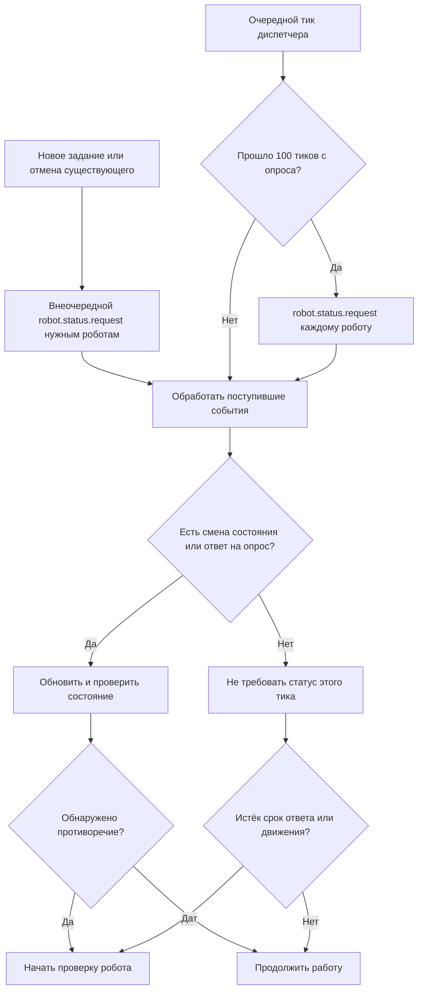

# Робот: XState-актор

Статус: согласуемая модель. См. [протокол и цикл](sim-engine.md) и [диспетчер](dispatcher.md).

## Граница ответственности

XState-актор робота выполняется на бэкенде, в памяти того же процесса, что и диспетчер данного запуска. Он создаётся серверным sim-engine. Фронтенд получает представление состояния робота и его маршрута для отображения; экземпляры акторов, их контекст и очередь событий остаются на сервере.

Актор хранит позицию:
- принятое назначение вместе с маршрутом
- собственное состояние.
- самостоятельно формирует следующее намерение и отправляет его диспетчеру.

Только после подходящего разрешения актор атомарно меняет логическую координату и продвигает индекс маршрута.

Намерения, разрешения и подтверждения — внутренние сообщения бэкенда. Браузер не отправляет `robot.move.intent` или `robot.move.completed` и не определяет координаты. Пользовательские команды поступают через серверный API с проверкой прав, затем обрабатываются диспетчером. Закрытие браузера или потеря соединения не останавливает актора и симуляцию.

Робот не выбирает себе задание, не рассчитывает глобальные конфликты и не выполняет движение по собственному таймеру. Плавную анимацию рисует фронтенд по серверным координатам.

## MVP

Первый MVP описан в [robot-mvp.md](robot-mvp.md): один робот, один замкнутый маршрут и проверка прохождения одного круга. Ниже описана полная модель; диспетчеризация, управление, опросы и их инварианты относятся к следующим этапам.

## Жизненный цикл

Актор представляет существующего робота, а не отдельное задание или запуск симуляции. При старте серверного процесса для зарегистрированных роботов создаются акторы; робот, добавленный позднее, получает актор при создании. Актор существует до завершения процесса либо явного удаления соответствующего робота командой `robot.delete`.

`robot.stop`, пауза, поломка, завершение задания, остановка и сброс запуска не удаляют актор. `stopped` — рабочее состояние живого актора: он хранит позицию, отвечает на запросы статуса и может принять новое назначение. Его владелец — долгоживущий серверный реестр роботов; жизненный цикл актора не привязывается к состоянию выполнения задания или к одному `SimulationRun`.

Удаление физического робота — отдельная доменная операция `robot.delete` с `commandId` и `robotId`, не синоним `robot.stop`. В первой версии она допускается только при остановленном запуске, отсутствии назначения, намерения и незавершённых резерваций робота; иначе возвращается отказ. Серверный владелец обрабатывает удаление, исключает робота из реестра и занятости и прекращает работу его актора. Подтверждение удаления формирует владелец, а не уже остановленный актор. Повтор команды не создаёт повторных последствий, сообщения удалённому роботу отклоняются.

Сброс запуска выполняется существующим актором на границе остановленной симуляции: он очищает данные прежнего запуска и принимает новую исходную позицию. Это отдельный переход сброса, не разрешение обычного шага. Новый `runId` отделяет сообщения прежнего запуска; их поздняя доставка не меняет состояние робота.

При завершении процесса исчезает экземпляр актора в памяти, но это не означает удаления записи робота. При следующем старте экземпляр создаётся заново; автоматическое продолжение прерванного задания не требуется.

## Полная модель данных

```ts
type RobotContext = {
  id: RobotId;
  name: string;
  position: Position;

  assignment: RobotAssignment | null;
  pendingIntent: MoveIntent | null;
  lastCompletedTick: TickId | null;

  blockedTicks: number;
  waitReason: WaitReason | null;
};

type RobotAssignment = {
  taskId: TaskId;
  version: number;
  route: RobotRoute | null;
};

type RobotRoute = {
  goal: Position;
  steps: Position[];
  nextStepIndex: number;
};

type WaitReason =
  | { type: "routeRequired" }
  | { type: "occupied"; robotIds: RobotId[] }
  | { type: "reserved"; robotIds: RobotId[] }
  | { type: "headOn"; robotIds: RobotId[] }
  | { type: "noDynamicPath" };
```

В назначении хранится один маршрут движения. Робот не разделяет его по операциям на станциях. `route: null` допустим, пока диспетчер готовит путь. `steps` содержит будущие клетки; следующий шаг — `steps[nextStepIndex]`. При замене маршрута увеличивается `assignment.version`.

## Состояния машины

| Область | Состояния |
|---|---|
| Исполнение | `idle`, `moving` |
| Работоспособность | `operational`, `broken` |
| Режим | `active`, `paused`, `stopped` |

В фазах поездки протокол движения выражается вложенными состояниями `ready`, `awaitingDecision`, `blocked`. Ожидание маршрута определяется отдельным состоянием или условием `assignment.route === null`; конкретная структура машины уточняется при реализации.

Работоспособность и режим могут быть параллельными областями XState. Общие условия запрещают движение при `broken`, `paused` или `stopped`. Активное состояние машины не дублируется независимо изменяемыми флагами в контексте. В полной модели `robot.stop` переводит режим в `stopped`, исполнение в `idle` и очищает назначение. Новое назначение принимается из `stopped` только исправным роботом и переводит режим в `active`; при паузе назначение отклоняется.

Основная последовательность:

```text
idle → moving → idle
```

Поломка и пауза сохраняют текущую фазу и назначение. После ремонта маршрут проверяется диспетчером до возобновления движения.

## Формирование намерения

Запрос статуса может быть плановым (раз в 100 тиков) или внеочередным при новом задании, отмене текущего либо диагностике. Робот отвечает одинаково; запрос сам по себе не меняет назначение и не останавливает движение.

Актор публикует статус при смене состояния и отвечает на контрольные запросы диспетчера каждые 100 тиков. Намерение формируется самостоятельно при готовности к следующему шагу в atWaypoint; в moving новый запрос не требуется. robot.tick может использоваться как внутреннее событие времени, но не требует публикации статуса. Проверки описаны в [разделе контроля](#публикация-состояния-и-контрольный-опрос).

Условия отправки:

- робот исправен и активен;
- текущая фаза — поездка;
- принят актуальный маршрут с доступным следующим шагом;
- нет ожидающего решения намерения;
- робот ещё не отправлял намерение текущего тика.

До отправки актор записывает `pendingIntent`, затем отправляет событие `robot.move.intent`. Пока результат не получен, другого намерения нет. На обычном тике без смены состояния публикация статуса не требуется. Диспетчер управляет очередями и исключает дубли тиков, назначений и решений до доставки актору; собственный журнал дедупликации робот не хранит.

## Обработка событий

Робот записывает полученные команды и результат их обработки в серверный лог через адаптер логирования. Записи содержат адресата, тип команды, доступные метаданные корреляции, состояние и позицию до и после обработки, результат и причину отказа. История хранится в системе логирования и не является локальной очередью исполнения или журналом дедупликации. Правила описаны в [разделе журналирования](#журнал-команд-робота).

Каждая команда диспетчера роботу содержит `robotId`. Перед обработкой актор проверяет совпадение с собственным ID; чужая команда не меняет его состояние. Это требование распространяется на назначение, замену маршрута, решения о движении, запрос статуса и команды управления.

| Событие | Действие актора |
|---|---|
| `robot.task.assign` | Проверить доступность, сохранить назначение с маршрутом движения, перейти в `moving`, подтвердить или отклонить |
| `robot.route.replace` | Проверить задание, версию и путь от текущей позиции; заменить маршрут и подтвердить |
| `robot.move.granted` | Сопоставить с ожидающим намерением, проверить состояние, выполнить шаг или сообщить отказ |
| `robot.move.denied` | Сохранить позицию и индекс маршрута, очистить намерение, увеличить ожидание |
| `robot.break` | Сохранить позицию и назначение, отменить намерение, перейти в `broken`, сообщить диспетчеру |
| `robot.repair` | Перейти в `operational`, сообщить диспетчеру; ожидать проверки маршрута |
| `robot.pause` | Приостановить исполнение и отменить неисполненное намерение |
| `robot.resume` | Разрешить исполнение; при готовности самостоятельно отправить новое намерение |
| `robot.stop` | Прервать назначение по [правилам управления](#команды-состояния), сохранить позицию, отменить намерение и сообщить диспетчеру идентификатор прерванного задания |

Отмена намерения должна быть известна диспетчеру. При внешних командах диспетчер удаляет его из обработки до разрешений. Замена маршрута с уже отправленным намерением согласуется диспетчером; новое намерение ставится в очередь и не исполняется повторно в текущем тике.

При разрешённом шаге актор проверяет `runId`, `tickId`, версию назначения, совпадение `from` с позицией и `to` со следующим шагом. Номер тика обработки задаёт диспетчер в решении. Успешный переход изменяет позицию, увеличивает индекс, очищает намерение, сбрасывает ожидание и отправляет `robot.move.completed`. Повторное разрешение не выполняется.

После последнего шага робот подтверждает движение с признаком завершения маршрута, очищает назначение и переходит в `idle`. Если он уже находится в цели и маршрут пуст, назначение завершается без движения. Смысл станции и дальнейшие операции определяет диспетчер; актор выполняет только переданный маршрут движения.

## Инварианты полной модели

Общие инварианты позиции, шага, команд, подтверждений и жизненного цикла R1–R18 определены в [расширенном протоколе](#инварианты) и применяются к полной модели. Состояния расширенного протокола соответствуют режимам и вложенным состояниям полной машины. Дополнительно:

- В `broken` запрещены новые намерения и перемещения; робот продолжает занимать клетку.
- Пауза и поломка сохраняют назначение и маршрут. После ремонта диспетчер проверяет маршрут до возобновления движения.
- Снятие паузы не ремонтирует робота: неисправный робот остаётся неподвижным.
- Новое назначение из `stopped` принимает только исправный робот; назначение во время паузы отклоняется.
- `robot.stop` очищает назначение и намерение, переводит режим в `stopped`, исполнение в `idle`. Прерванное задание не становится успешно завершённым.
- Назначение робота описывает один маршрут движения. Его завершение не подтверждает выполнение каких-либо операций на станции.

Проверки полной модели дополняют минимальный круговой маршрут диспетчеризацией, управлением, поломкой и ремонтом.

## Расширенный протокол после MVP

Следующие разделы перенесены из прежней расширенной версии MVP и не входят в минимальный сценарий кругового маршрута.

## Публикация состояния и контрольный опрос

Робот отправляет `robot.status` в очередь диспетчера только при создании, фактической смене состояния машины и в ответ на `robot.status.request`. Обычный тик без смены состояния не создаёт сообщения. Ответ на запрос отправляется даже при неизменном состоянии; это исключение из публикации только изменений.

Спонтанный статус содержит `tick: null`. Ответ на запрос содержит тик из `robot.status.request`: это идентификатор опроса, а не тик последнего движения. Намерение и подтверждение шага содержат тик намерения. Робот не хранит последний отправленный статус: сообщение формируется действием перехода, а запрос обрабатывается без смены состояния.

Каждые 100 общих тиков диспетчер отправляет всем зарегистрированным роботам `robot.status.request` с их `robotId` и тиком опроса. Полученные состояния сверяются с представлением диспетчера. Поздний ответ старого опроса не закрывает ожидание нового. Срок ответа задаётся отдельно в настройках runner; истечение 100 тиков означает начало опроса, а не автоматическое признание робота неисправным. Обязательного опроса на каждом тике нет.

Диспетчер также может отправить внеочередной `robot.status.request` при получении нового задания или отмене существующего. Для нового задания опрашиваются роботы-кандидаты, для отмены — робот, которому назначено отменяемое задание. Формат запроса и ответа тот же; ближайший плановый опрос не откладывается. Сам запрос не отменяет задание и не останавливает робота: для этого используются команды управления и их подтверждения.

На одного робота допускается не более одного незавершённого запроса статуса. Несколько причин опроса объединяются, если между ними не применялась меняющая состояние команда. Если после такой команды нужен свежий ответ, диспетчер завершает или закрывает прежний запрос и отправляет новый с другим номером тика. Два разных запроса одному роботу в одном тике не отправляются: пары `robotId + tick` должно хватать для однозначного сопоставления ответа. Это ограничение очереди диспетчера, а не дополнительное поле в роботе.

Намерение — самостоятельное сообщение, а не часть статуса. При переходе в `atWaypoint` с оставшимся маршрутом робот готовит запрос на ближайшем допустимом тике. Диспетчер не проверяет отсутствие запроса сразу при получении статуса: он дожидается обработки сообщений и ближайшей фазы подготовки намерений. Если робот уже в `awaitingPermission`, должно существовать соответствующее намерение в очереди или текущем наборе диспетчера.

Процедура проверки запускается при отсутствии ответа на контрольный запрос в установленный срок, противоречии ответа данным диспетчера, отсутствии ожидаемого намерения после фазы подготовки либо превышении допустимого времени движения. Тишина между сменами состояния и опросами сама по себе ошибкой не является.

При проверке диспетчер сохраняет занятость клеток и резервации, запрашивает актуальный статус и сверяет снимок актора. В MVP подтверждённая ошибка приостанавливает выдачу новых разрешений и публикуется владельцу. Уже начатые переходы продолжают завершаться; неизвестная позиция не подменяется последней достигнутой. Робот автоматически не удаляется. Продолжение возможно после устранения причины и явной команды.



## Команды состояния

В MVP `robot.pause` и `robot.stop` принимаются только на достигнутой точке, то есть вне `moving`. Если переход уже начат, актор отвечает `robot.control.rejected`, остаётся в `moving` и сохраняет `pendingMove`. Диспетчер может запретить следующий переход и после прибытия отправить новую команду управления. Физическая остановка между клетками требует отдельной модели позиции и в этот MVP не входит.

| Команда | Результат |
|---|---|
| `robot.pause` | Сохранить позицию и назначение, отменить намерение, перейти в `paused` |
| `robot.resume` | Только из `paused`: перейти в `atWaypoint` при наличии назначения, иначе в `idle`; ждать следующего robot.tick |
| `robot.stop` | Сохранить позицию, очистить назначение и намерение, перейти в `stopped` |

После принятой команды отправляются `robot.control.applied` и текущий статус. Неприменимая команда получает `robot.control.rejected` без изменения состояния. Диспетчер знает назначенное задание и сохраняет его идентификатор перед отправкой `robot.stop`; идентификатор прерванного задания не дублируется в ответе робота.

Прерывание задания фиксируется только после `robot.control.applied`, а не по факту отправки `robot.stop`. До отправки диспетчер сохраняет связь команды с заданием; отказ не очищает назначение и не меняет его результат.

Команды применяются до разрешений движения. Уже выполненный шаг не откатывается. В `stopped` робот принимает новое назначение, но `robot.resume` не восстанавливает старый маршрут.

## Журнал команд робота

Робот ведёт журнал команд в серверном логе через переданный адаптер логирования. История хранится в системе логирования, а не растущим массивом в `RobotContext`. Очередь ожидающих команд и контроль дублей остаются у диспетчера; лог робота фиксирует фактически полученные им команды и результат обработки.

Для команды записываются тип события, адресованный `robotId`, собственный ID актора, время записи, тик (если он есть у команды), состояние и позиция до обработки. Затем записываются результат — применена или отклонена, причина отказа и состояние и позиция после обработки. Если сквозной `commandId` доступен в метаданных доставки, он включается в запись; ради лога робот не создаёт собственного счётчика команд.

Получение разрешения движения и фактическое прибытие — отдельные записи: начало перехода не отмечается как завершение шага. Событие `robot.waypoint.reached` и отправка `robot.move.completed` позволяют проследить завершение разрешённого движения. Команда с чужим `robotId` также журналируется как отклонённая без изменения состояния.

Логирование не создаёт дополнительных `robot.status` на каждом тике и не заменяет подтверждение диспетчеру. История не воспроизводится автоматически как очередь команд.

## Инварианты

- **R1. Позиция:** координаты меняет только актор: по событию прибытия ранее разрешённого перехода либо отдельной операции сброса полностью остановленного запуска. Выдача разрешения сама по себе координату не меняет.
- **R2. Геометрия:** шаг ведёт в соседнюю клетку по четырём направлениям; диспетчер проверяет границы и препятствия.
- **R3. Назначение:** у робота не более одного назначения; маршрут находится внутри него. Для замены активное назначение сначала останавливается через `robot.stop`. Только после `robot.control.applied`, очистки прежнего назначения и перехода в `stopped` допускается `robot.task.assign` с новым назначением. Отправка команды остановки без подтверждения не разрешает замену; при отказе остановки прежнее назначение сохраняется.
- **R4. Адресация и разрешение:** каждая команда диспетчера содержит `robotId`, совпадающий с ID актора. Начать движение можно только в `awaitingPermission` при совпадении `tick` с `pendingMove.tick`; повторное, чужое или отменённое разрешение не двигает робота.
- **R5. Частота событий:** статус публикуется при смене состояния и по запросу, а не на каждом тике. Диспетчер опрашивает всех роботов каждые 100 тиков и может запросить состояние вне очереди при новом задании или отмене текущего. Намерение формируется только для нового шага; в `awaitingPermission` и `moving` повторное намерение не требуется.
- **R6. Маршрут:** успешный шаг удаляет ровно одну клетку; отказ не меняет позицию и маршрут.
- **R7. Неподвижность:** в `paused` и `stopped` намерения и движение запрещены; клетка остаётся занятой.
- **R8. Пауза:** принятая пауза на достигнутой точке сохраняет позицию и назначение; ещё не разрешённое намерение отменяется у робота и диспетчера. В `moving` команда отклоняется без отмены перехода.
- **R9. Продолжение:** не выполняет шаг само по себе; следующий шаг требует нового намерения и разрешения.
- **R10. Стоп:** принятая остановка на достигнутой точке очищает назначение и намерение, сохраняет позицию; задание не отмечается успешно завершённым. В `moving` команда отклоняется, а назначение и переход сохраняются.
- **R11. Новое назначение:** принимается только в `idle` или `stopped`; в `paused` отклоняется.
- **R12. Атомарность:** координата и оставшийся маршрут меняются одним переходом; команды не откатывают завершённый шаг.
- **R13. Очередь, повторы и лог:** диспетчер контролирует очередь и подавляет повторные команды до доставки роботу; старый стоп не затрагивает новое назначение. Робот журналирует полученные команды и результаты в серверном логе, но не ведёт собственную очередь или журнал дедупликации. Ограничение одного активного назначения обеспечивается диспетчером и дополнительно проверяется состоянием актора.
- **R14. Контроль:** отсутствие статуса между изменениями и опросами не является ошибкой. Ответ на опрос обязателен в установленный срок; в нём повторяется тик запроса. Отсутствие ожидаемого намерения проверяется после фазы подготовки, движение — по сроку перехода. Подтверждение шага отправляется только после прибытия.
- **R15. Завершение:** `routeCompleted` истинно после последнего шага; пустой маршрут не создаёт фиктивного подтверждения шага.
- **R16. Занятость:** диспетчер резервирует исходную клетку, целевую клетку и переход от разрешения до обработки подтверждения прибытия. Исходная клетка освобождается после прибытия; целевая остаётся занятой роботом. Резервации не освобождаются в конце каждого тика, при тайм-ауте или по отсутствию отчёта `moving`. Отсутствие конфликтов гарантирует диспетчер, а не отдельный актор.
- **R17. Время жизни:** остановка и завершение маршрута не прекращают актор.
- **R18. Удаление:** текущая клетка перестаёт быть занятой удаляемым роботом при явном удалении; операция допускается только без активного назначения, перехода, намерений и резерваций. Это не запрещает обычное освобождение предыдущей клетки после прибытия в следующую точку.
